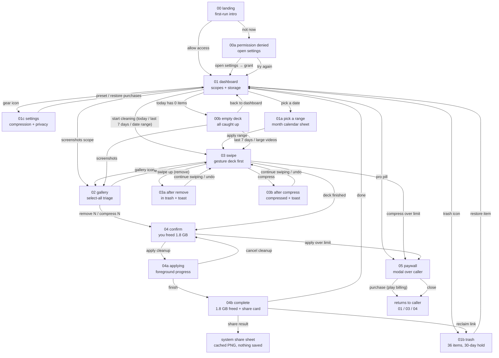

# swipe media — dark board user flow

Product: **swipe media** — a swipe-based photo & video cleanup app.
Design source: FigCraft file `v3`, page **4 - Nov 25 2026 - v4** (15 frames; 6-column base row).
Board layout: the six base screens (`00`, `01`, `02`, `03`, `04`, `05`) run in one horizontal row; every lettered variant sits directly under its parent (`00a`/`00b` under `00`, `01a`/`01b`/`01c` under `01`, `03a`/`03b` under `03`, `04a`/`04b` under `04`). Variant labels are set one step smaller and dimmer than base labels.
Scope: first run (permission), dashboard scopes, swipe-first cleanup, results, share, trash, settings and pro.
All numbers on the board are disclosed sample data, not claims — they reconcile with each other (see the ledger at the end).

**v4 renumber:** the old numbering kept a hole where login (`01`) used to be. Screens are renumbered to match the horizontal reading order: `02→01 … 06→05` (variants follow: `02a→01a`, `04a→03a`, `05a→04a`, …). Map to v3 names: dashboard `01` (was 02), gallery `02` (was 03), swipe `03` (was 04), confirm `04` (was 05), paywall `05` (was 06).

**v4 changes:** the paywall is drawn the way it behaves — a sheet over a dimmed `04 confirm`, not a standalone screen; `04a applying` lost its top-right X (cancel cleanup is the only exit); `04 confirm` states the trash reservation before the run, not just after; `00 landing`'s hero is a three-card deck caught mid-drag; scope cards and shortcut rows carry real media thumbnails instead of drawn glyphs; the swipe legend reads `→ keep` instead of `→ next`; the `PRO` pill is lowercase `pro`, matching the app's voice; 13px grays were lifted one step for legibility; trash copy speaks human ("take up space", not "android storage").

---

## 1. Flow map

The daily loop is **01 → 03 → 04 → 04a → 04b → 01**. `02 gallery` is the batch-triage surface behind the gallery icon (and the default for the screenshots scope), not the default destination of `start cleaning`.

---

## 2. Screen-by-screen detail

### 00 · landing — first-run intro
| | |
|---|---|
| Purpose | Explain the product in one glance and ask for photo-library access. |
| Entry | First app open. |
| Seen | Wordmark `swipe media` · headline `free up your phone` · subline `clean your photos and videos with a swipe. keep what matters.` · **a three-card deck caught mid-drag**: two cards stacked behind, the top photo tilted −5° with the violet `↑ remove` chip on it — the signature gesture previewed before the app opens · trust block: `ready to scan your library` + `scans stay on this phone. private, instant, and nothing leaves your device.` |
| Primary action | **allow access** — Android Photos & Videos permission. |
| Secondary action | **not now** — goes to `00a` (nothing can be scanned without access). |
| Exits | allow access → `01 dashboard` · not now → `00a permission denied`. |

### 00a · permission denied
| | |
|---|---|
| Purpose | Explain why photo/video access is needed locally and recover from a denial. |
| Entry | `00 not now`, a denied system prompt, or access revoked in Android settings. |
| Seen | Lock badge · title `library access is off` · body `swipe media needs access to your photos and videos to scan this device locally. nothing is uploaded.` · card `turn it back on` with three steps: `open settings`, `apps → swipe media`, `permissions → photos & videos` · footnote `you can revoke access anytime. scans stay on this phone.` |
| Primary action | **open settings** — deep-links to the app's Android permission page. |
| Secondary action | **try again** — re-requests the permission. |
| Exits | both return to `01 dashboard` once access is granted. |

### 00b · empty deck
| | |
|---|---|
| Purpose | Turn an empty scope into another cleanup instead of a dead end. |
| Entry | Opening a scope that has 0 items (mock: `today`). |
| Seen | Check badge · title `all caught up for today!` · body `nothing left to review in today's set. pick another scope and keep going.` · three shortcut rows: `last 7 days — 312 items · 7.8 GB` (calendar glyph), `large videos — 38 videos · 12.4 GB` (**real video thumbnail, 44 px, with a 0:12 duration chip**), `screenshots — 1,204 shots · 3.1 GB` (**real screenshot thumbnail, 44 px**) |
| Primary action | **clean last 7 days** — opens `03 swipe` for that scope. |
| Secondary action | **back to dashboard**. |
| Exits | last 7 days / large videos → `03 swipe` · screenshots → `02 gallery` · back → `01`. |

### 01 · dashboard — storage and scope
| | |
|---|---|
| Purpose | Show the payoff (space saved) and choose the next scope, plus reach trash, settings and pro. |
| Entry | After permission, after every completed run (`04b done`), and after billing. |
| Header | Wordmark + `trash (36)` · compact `pro` pill · `settings` gear · trash icon with `36` badge. |
| Figure | `9.4 GB` / `saved so far` · bar `58.2 GB used` / `5.8 GB free` (of 64 GB, ~91% full). |
| Seen | Section `clean what first?` · two high-yield cards: `large videos — 38 · 12.4 GB` (**real 36×27 video thumbnail**) and `screenshots — 1,204 · 3.1 GB` (**2×2 mini-grid of real screenshots, 16×12 each**) · label `or by date` · rows: `today — 84 items — 2.1 GB` **(selected)** · `yesterday — 132 items — 6.4 GB` · `last 7 days — 312 items — 7.8 GB` · `pick a date — any range you choose — choose`. |
| Primary action | **start cleaning** — opens `03 swipe` on the selected scope (gallery is one tap away via the deck's gallery icon). |
| Secondary access | `pro` → `05` (modal) · gear → `01c` · trash → `01b` · `pick a date` → `01a` · `screenshots` → `02` for select-all batching. |
| Exits | start cleaning → `03 swipe` (mock: today, 84 items) · screenshots → `02 gallery`. |

### 01a · pick a range — month calendar sheet
| | |
|---|---|
| Purpose | Choose any start/end range, including months from past years, before scanning. |
| Entry | `01 pick a date`. |
| Seen | Dimmed dashboard behind a bottom sheet · grabber · `pick a date range` · hint `jun 15 – jun 18 · 4 days` · `‹ june 2026 ›` · weekday header `M T W T F S S` · 6 × 7 day grid (June 2026 starts Monday; trailing July days dimmed) · range 15–18 filled violet with solid endpoints · today (23) outlined · `apply range` · `cancel`. |
| Primary action | **apply range** — opens `03 swipe` for those days. |
| Secondary action | **cancel** — closes the sheet, keeps the previous scope. |
| Exits | apply → `03 swipe` · cancel → `01 dashboard`. |

### 01b · trash — the 30-day safety net
| | |
|---|---|
| Purpose | Prove the `04 confirm` promise: everything is held for 30 days and can come back. |
| Entry | `01` trash icon (badge `36`), or the `04b` reclaim link. |
| Seen | Back icon · `trash` · `36 items · 1.8 GB` · `held for 30 days, then deleted for good.` · 5 preview rows (thumbnail, filename, size, `29d left` chip, `restore`): `IMG_2494.MOV 48.6 MB`, `IMG_2481.HEIC 4.2 MB`, `Screenshot_0623 2.8 MB`, `IMG_2470.HEIC 6.1 MB`, `IMG_2455.MOV 96.3 MB` · `showing 5 of 36 · newest first` · `these still take up space until you empty the trash.` · link `empty trash to free 1.8 GB now →`. |
| Primary action | **restore** (per row) — returns the file to the library. |
| Destructive action | **empty trash now** — permanently deletes the 36 items and actually releases the 1.8 GB; note `this can't be undone.` |
| Truth | `MediaStore` trashed files still occupy physical disk until the 30 days expire or the trash is emptied. The screen says so in plain words. |
| Exits | restore → `01 dashboard` with the badge decremented · back → `01`. |

### 01c · settings
| | |
|---|---|
| Purpose | Set the compression default, manage pro, and state the privacy model. |
| Entry | `01` gear icon. |
| Seen | Back icon · `settings` · section `compression preset` · rows `balanced — 1080p · keeps quality` **(selected)** and `max savings — 720p · smallest files` · section `subscription` · card `swipe media pro`, `free plan · 1 cleanup a day`, `restore purchases`, `manage plan` · section `privacy` · card `privacy statement`, `photos never leave this device.`, `no account, no upload.` · `swipe media 3.0.0 (build 308)` · `no account needed. cleanups stay on this phone.` |
| Actions | pick a preset · restore purchases · open privacy statement · manage plan. |
| Exits | back → `01 dashboard` · manage → `05 paywall` (modal). |

### 02 · gallery — select by tapping
| | |
|---|---|
| Purpose | Grid overview of the chosen scope; the precise alternative to swiping (and the best path for screenshots). |
| Entry | `01 screenshots` scope, or the gallery icon in `03`. |
| Seen | Back icon · `select all` (dashed square + check) · `swipe mode` icon · title `today` · meta `84 items, 2.1 GB` · full-bleed 3-column grid (130 px tiles, no gaps) · tap toggles selection (accent stroke + ✓ badge; mock shows 3) · bottom gradient scrim behind a floating dock: `3 selected` / `18.4 MB`, **remove 3** (primary), **compress 3**. |
| Primary actions | **remove N** — moves selected items to trash · **compress N** — keeps compressed copies, originals go to trash · **swipe mode** → `03` for the same scope · **select all** — selects the visible tiles. |
| Exits | swipe mode → `03` · remove/compress → totals into `04 confirm` · back → `01`. |

### 03 · swipe — the core loop
| | |
|---|---|
| Purpose | Fast, gesture-driven keep-or-clean pass over the scope's media. This is the default destination of `start cleaning`. |
| Entry | `01 start cleaning`, `01a apply range`, `00b` shortcuts, or `02 swipe mode`. |
| Seen | Back icon · gallery icon (minimal, 22 px) · progress `12 of 84` · session tally `600.0 MB saved` · bar at 14% · media card inset 24 px from the screen edges on a stacked deck · filename row `IMG_2481.HEIC · 4.2 MB` · gesture legend `← previous`, `→ keep`, `↑ remove` (violet tint) · a solid violet `↑ remove` stamp with a soft shadow over the card while dragging · compact icon-only **undo** and **compress** (44 px). |
| Gestures | Swipe **up** = remove to trash (the violet stamp previews it before release) · swipe **left** = previous item · swipe **right** = keep and advance. The legend and the handler use the same three directions — there is no downward gesture. |
| Android | The 24 px inset plus `setSystemGestureExclusionRects()` on the card means edge-back never competes with a horizontal swipe. |
| Primary action | **compress** — compress the current item in place (over the free limit → `05` modal). |
| Undo | **undo** reverses the last remove/compress. |
| Exits | actions update in place (`03a`, `03b`) · deck finished → `04 confirm` · gallery icon → `02`. |

### 03a · after remove — state of a swiped-up item
| | |
|---|---|
| Purpose | Show the moment right after a media item was removed. |
| Entry | Swipe up (remove) on the current card (mock: the 4.2 MB lantern photo). |
| Seen | Same top bar as `03` (back and gallery icons, no text pills) · progress `13 of 84` and `604.2 MB saved` **below** the media · bar at 16% · the removed item desaturated under a light scrim with an `in trash` badge · toast `moved to trash` + `4.2 MB freed` over the card's lower edge · compact 44 px undo/compress icons. |
| Primary action | **undo** — restores the item to `03`'s previous state. |
| Note | Removal is never destructive here: the item sits in trash for 30 days. |
| Exits | continue swiping → `03` · deck finished → `04`. |

### 03b · after compress — state of a compressed video
| | |
|---|---|
| Purpose | Show the moment right after compressing a media item (mock uses a video — the biggest win). |
| Entry | Compress on the current card (mock: `IMG_2494.MOV · 0:12`). |
| Seen | Same top bar as `03` · progress `13 of 84` and `635.7 MB saved` **below** the media · the video card with a `compressed` badge, duration chip and play affordance · size drops `48.6 MB → 12.9 MB` · toast ✓ `video compressed` + `35.7 MB freed` · compact 44 px undo/compress icons. |
| Semantics | Compression keeps a copy: the **originals go to trash**, the compressed copy stays in the library. |
| Primary action | **undo** — reverses to the original file. |
| Exits | continue swiping → `03` · deck finished → `04`. |

### 04 · confirm — the session summary
| | |
|---|---|
| Purpose | Prove the payoff of the finished session and offer the reversal — with the storage truth stated up front. |
| Entry | End of a cleaning session (deck finished or gallery actions tallied). |
| Seen | Back icon · success check circle · title `you freed 1.8 GB` · subline `apply cleanup to make it real.` · bar `56.4 GB used` / `7.6 GB free` (of 64) · destination card `24 removed — 1.2 GB` with `→ trash`, divider, `12 compressed — 600.0 MB` with `copies kept, originals in trash` · `nothing changes until you apply.` · `trash holds everything for 30 days. 1.8 GB stays reserved until you empty it.` |
| Primary action | **apply cleanup** — commits the batch and starts `04a`. If the free daily limit is spent, `05` opens as a modal; buying resumes `04a` with the queue intact, closing returns here. |
| Reversal | **discard** — drops the whole session and returns to `01`. |
| Exits | apply → `04a` (or `05` → `04a`) · discard → `01`. |

### 04a · applying — foreground progress
| | |
|---|---|
| Purpose | Survive the 30–90 s re-encode of 12 videos without Android killing the job. |
| Entry | `04 apply cleanup`. |
| Seen | `applying cleanup` (no close X — **cancel cleanup** at the bottom is the only exit) · `in progress` pill · `35%` · `of 12 videos compressed` · bar at 35% · `210 MB freed so far` · `compressing video 3 of 12` · job card: `now compressing`, `IMG_2510.MOV`, `62.4 MB → 24.8 MB`, per-item bar at 60%, `video 3 of 12 · 60%`, `up next` `IMG_2518.MOV 96.3 MB`, `IMG_2522.MOV 41.2 MB`, `+ 8 more`, `estimated 1:40 left` / `600 MB total` · note `keeps running in the background` + `android won't stop the job if you switch apps. one 'allow' at the end trashes all 36 items.` (foreground service) · `cancel cleanup`. |
| System trash | When encoding finishes, all 24 removed files + 12 compressed originals go into **one** `MediaStore.createTrashRequest()` call — the user taps Allow once for all 36, not 36 times. |
| Primary action | none — the job runs; the notification mirrors the progress. |
| Secondary action | **cancel cleanup** — stops the batch and returns to `04`. |
| Exits | finish → `04b` · cancel → `04`. |

### 04b · complete — reward and share
| | |
|---|---|
| Purpose | Close the loop with a win and turn it into a shareable card. |
| Entry | `04a` finishes. |
| Seen | Check circle · title `1.8 GB freed!` · subline `11.2 GB saved so far.` (9.4 + 1.8) · violet gradient share card: `swipe media`, `jun 23, 2026`, `1.8 GB`, `freed on my phone today`, before/after meter `58.2 → 56.4 GB used`, `no cloud. no upload.`, `30-day undo` · `1.8 GB is reserved in 30-day trash.` · link `empty trash to free space now →`. |
| Storage truth | The share card's `56.4 GB used` is what Android reports after the batch: trashed files still occupy the disk until the 30 days expire or the trash is emptied. The link goes to `01b` so the user can reclaim the space immediately. |
| Primary action | **share result** — writes the card PNG to `cacheDir` and opens the system share sheet through a `FileProvider`. Nothing is written to the camera roll unless the user saves it from the sheet. |
| Secondary action | **done** — returns to `01 dashboard` with `11.2 GB saved` and `7.6 GB free` (minus whatever remains reserved in trash). · **reclaim link** → `01b`. |
| Exits | share → system sheet · reclaim → `01b` · done → `01`. |

### 05 · paywall — modal sheet over the caller
| | |
|---|---|
| Purpose | Convert at the moment of value (limit hit, compress, or pro tap) without an account, without losing the active session. |
| Entry | `01 pro` · `01c manage plan` · `03 compress` over the limit · `04 apply cleanup` over the limit. |
| Presentation | **Drawn as what it is:** a dimmed, 30%-opacity ghost of `04 confirm` behind a scrim, with the offers in a rounded-corner bottom sheet (same visual grammar as the `01a` calendar sheet). Close returns to the caller: `01`, `03` or `04` exactly as it was. |
| Seen (sheet) | Grabber · close X (no duplicate restore in the header) · `pro` pill + title `clean without limits` · subline `unlimited cleanups and max-savings compression.` · benefits `unlimited daily cleanups`, `720p max savings`, `unlimited video compression` · plans: `annual — $24.99 / year · $2.08 / month — save 85%` **(selected)**, `weekly — $3.99 / week`, `lifetime — $49.99 once` · **continue** · `google play billing · cancel anytime` · `restore purchases` · `terms · privacy · refunds`. |
| Free tier | **30-day trash + restore is free for every user** and is not part of pro. Pro sells volume and compression, not safety. |
| Primary action | **continue** — launches Google Play Billing. On success: from `04` → `04a applying` immediately with the queue intact · from `03` → the deck resumes with compression unlocked · from `01`/`01c` → back with pro active. |
| Secondary action | **restore purchases** — restores entitlements from the Google account (no app account). |
| Exits | purchase → caller continues · close → caller. |

---

## 3. Global rules (hold on every screen)

- **No account**: there is no sign-up, login or sync. Pro is tied to the Google account by Play Billing only.
- **Privacy**: scanning, matching and compression run on-device. `photos never leave this device.` Nothing is uploaded.
- **Trash is free**: every removal (swiped, batch-removed, or the original of a compression) goes to trash and is held **30 days** for everyone — never a pro feature. The dashboard badge counts trash items (`36`); `01b` lists them with days left, restore and empty-trash.
- **Trash and disk space**: trashed files still occupy storage until the 30 days expire or the user empties the trash. `04` states it before the run; `04b` and `01b` say it after, and both link to the trash so the space can be reclaimed immediately.
- **Compression**: always `copies kept, originals in trash` — nothing is silently lost. Compression defaults to Balanced 1080p; Max Savings 720p is available in settings.
- **Undo**: always available — per action on `03/03a/03b`, per batch on `02`, for the whole session on `04` (discard), and for 30 days via `01b`.
- **Scopes**: high-yield scopes (`large videos > 50 MB`, `screenshots`) sit beside the date scopes and carry **real media thumbnails** everywhere they appear (`01` cards and `00b` rows use the same anatomy). `start cleaning` opens the swipe deck; the screenshots scope opens the gallery for select-all.
- **Gestures**: swipe up = remove · swipe left = previous · swipe right = next (keep). The card stays inset 24 px and registers `setSystemGestureExclusionRects()`. The legend and the handler agree; there is no swipe-down action.
- **Paywall**: always a modal sheet over its caller and always returns there; a purchase made from `04` continues straight into `04a`.
- **Sharing**: the share card is generated into `cacheDir` and handed to the system sheet via `FileProvider`; it never appears in the camera roll on its own.
- **Voice**: lowercase everywhere, including the `pro` pill; no tracked-caps labels.
- **Design system**: Inter only; lowercase voice; one primary (`#7C5CFF`) action per screen; radii 999 pills / 40 device frames / 18–20 cards / 12 thumbnails; dark `#14121B` canvas; body grays `#AFA7C6` and up at small sizes (no 13px text on `#9E96B4`).

---

## 4. Sample-data ledger (the mock's numbers reconcile)

| Relation | Numbers |
|---|---|
| Total storage | 58.2 used + 5.8 free = **64 GB** (91% bar fill) |
| Today's set | dashboard + gallery `84 items · 2.1 GB` = swipe deck `12 of 84` in progress |
| Other scopes | `last 7 days 312 items · 7.8 GB` · `yesterday 132 · 6.4 GB` · `large videos 38 · 12.4 GB` · `screenshots 1,204 · 3.1 GB` |
| Remove example | lantern `4.2 MB` → toast `4.2 MB freed`; tally `600.0 → 604.2 MB saved` |
| Compress example | video `48.6 MB → 12.9 MB` → `35.7 MB freed`; tally `600.0 → 635.7 MB saved` |
| Session total | `24 removed (1.2 GB) + 12 compressed (600.0 MB)` = **1.8 GB freed** (the `03/03a/03b` tallies are mid-run snapshots; `04` summarizes the full run) |
| Progress screen | `35%` of `600 MB` = `210 MB freed so far`; `video 3 of 12` |
| After confirmation | `56.4 used` (58.2 − 1.8) + `7.6 free` (5.8 + 1.8) = 64 GB ✓ · saved total `11.2 GB` (9.4 + 1.8) — but 1.8 GB stays reserved in trash until emptied |
| Trash | `36 items · 1.8 GB` = 24 removed + 12 compressed originals, free for 30 days on every plan |
| Paywall | annual `$24.99/yr` ($2.08/mo, save 85%) · weekly `$3.99/wk` · lifetime `$49.99 once` |
